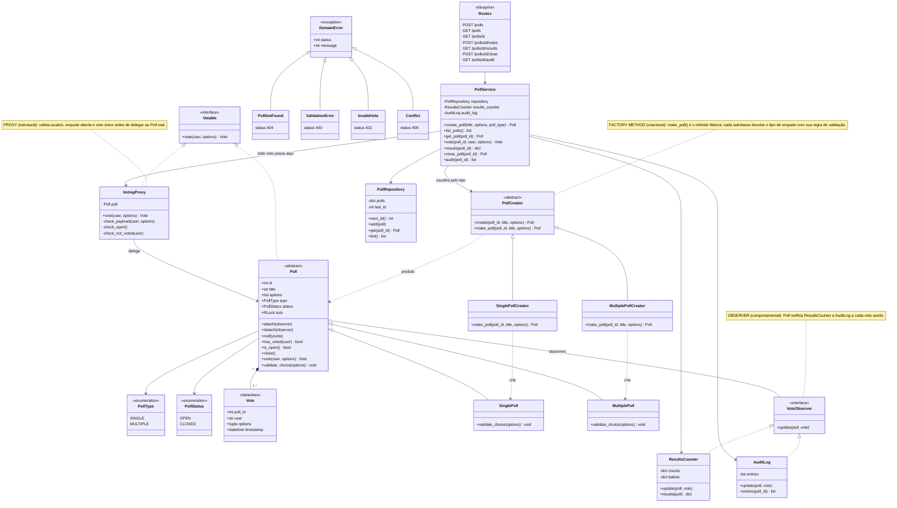
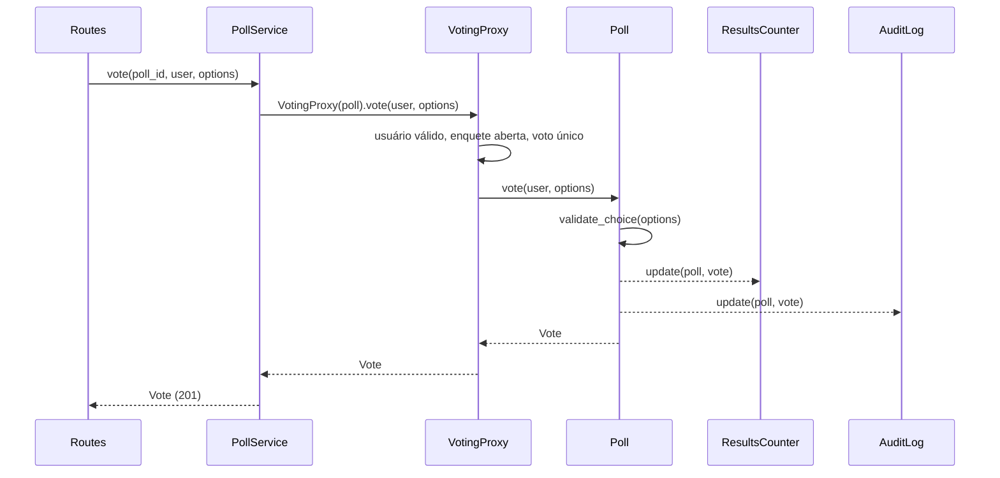
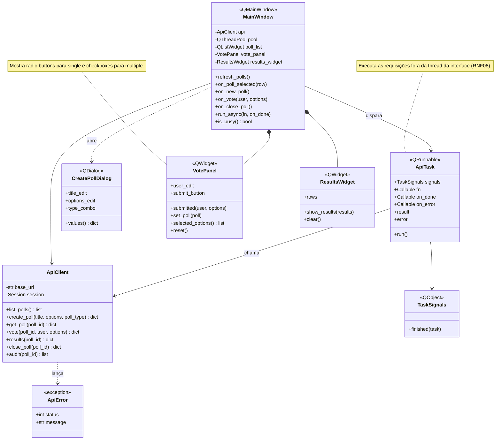

# Diagramas de Classes

Os padrões de projeto aparecem em notas e na tabela de rastreabilidade (seção 4).

## 1. Servidor

### Fluxo de um voto

### Ordem das verificações no Proxy
1. Usuário válido e formato das opções → senão `ValidationError` (400)
2. Enquete aberta → senão `Conflict` (409)
3. Usuário ainda não votou → senão `Conflict` (409)
4. Regra do tipo (`validate_choice`, dentro do `Poll`) → senão `InvalidVote` (422)

## 2. Contrato da API

| Método | Rota | Corpo | Sucesso | Erros |
|--------|------|-------|---------|-------|
| POST | `/polls` | `{title, options, type}` | 201 enquete | 400 |
| GET | `/polls` | n/a | 200 lista | n/a |
| GET | `/polls/<id>` | n/a | 200 enquete | 404 |
| POST | `/polls/<id>/votes` | `{user, options}` | 201 voto | 400, 404, 409, 422 |
| GET | `/polls/<id>/results` | n/a | 200 resultados | 404 |
| POST | `/polls/<id>/close` | n/a | 200 enquete | 404, 409 |
| GET | `/polls/<id>/audit` | n/a | 200 lista de entradas | 404 |

Formatos JSON:
- Enquete: `{id, title, type, status, options}`
- Resultados: `{poll_id, status, total_votes, results: {opção: contagem}}`
- Voto: `{poll_id, user, options}`
- Auditoria: `[{poll_id, user, options, timestamp}]`
- Erro: `{error: "mensagem"}`

## 3. Cliente

O cliente não implementa os três padrões obrigatórios. A comunicação entre
widgets usa signals e slots do Qt, que são o mecanismo nativo de observer do
framework.

## 4. Rastreabilidade dos padrões

| Padrão | Classes | Arquivo | Atende |
|--------|---------|---------|--------|
| Factory Method | `PollCreator`, `SinglePollCreator`, `MultiplePollCreator` | `server/factory.py` | RF05, RF06, CA17 |
| Proxy | `Votable`, `VotingProxy`, `Poll` | `server/proxy.py` | RF07 a RF09, CA18 |
| Observer | `VoteObserver`, `ResultsCounter`, `AuditLog` | `server/observers.py` | RF11, RF12, CA19 |
| Orquestração dos três padrões | `PollService` | `server/service.py` | RF04, RF11, RF12 |
